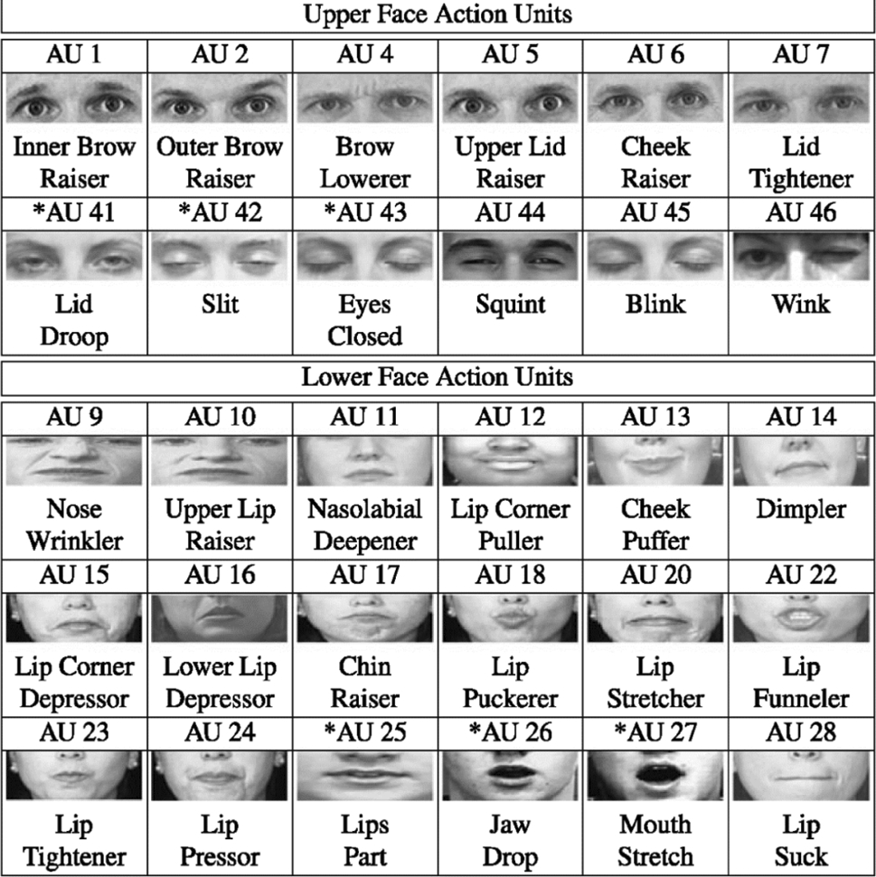
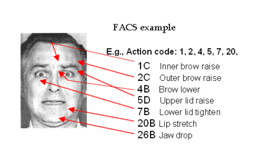
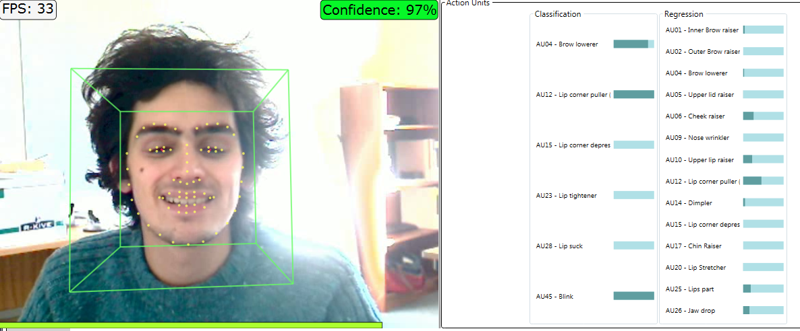
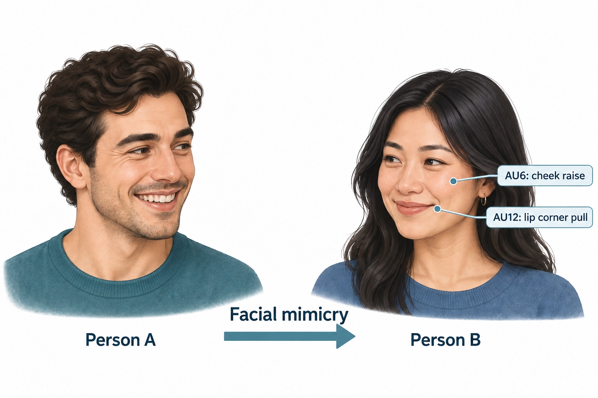

# Face

This chapter introduces the analysis of facial behaviour as an affective signal. You will work with features extracted from your own recording and explore facial action units and related visual information.

<strong>Facial Expression Recognition (FER)</strong>

We tend to use facial expressions to communicate with each other and also express our emotional state. A facial expression is one or more motions or positions of the muscles beneath the skin of the face. These movements are believed to convey the emotional state of an individual to observers. Thus, facial expressions are one form of nonverbal communication. [Source](https://en.wikipedia.org/wiki/Facial_expression)

Facial Expression Recognition (FER) analyses expressions in images or video. Expressions can be described using emotion categories, individual facial movements, or dimensions such as valence and arousal. Valence describes how pleasant or unpleasant an emotional state is; arousal describes its level of activation.

In Ekman's model, the seven emotion families are **anger, contempt, disgust, enjoyment, fear, sadness, and surprise**.

| Anger | Contempt | Disgust |
| --- | --- | --- |
|  |  |  |
| **Enjoyment** | **Fear** | **Sadness** |
|  |  |  |
| **Surprise** |  |  |
|  |  |  |

*Images and emotion-family descriptions: [Paul Ekman Group — Universal Emotions](https://www.paulekman.com/universal-emotions/).*

The meaning of an expression also depends on its context. A visible expression alone does not establish what a person is feeling.

<strong>Action Units</strong>

Action Units (AUs) describe observable facial movements associated with the action of one or more facial muscles. Each has a numerical code and a descriptive name.

A facial expression can involve several AUs together. Describing these movements lets us examine facial behaviour in detail without first assigning an emotion label.

*Image source: Zhi, Liu, and Zhang, [“A comprehensive survey on automatic facial action unit analysis”](https://link.springer.com/article/10.1007/s00371-019-01707-5), The Visual Computer 36 (2020), 1067–1093.*

AU measurements can describe whether a movement is present and how strong it is.

[Illustrated AU reference](https://www.cs.cmu.edu/~face/facs.htm) · [AU animations](https://imotions.com/blog/facial-action-coding-system/)

<strong>FACS — Facial Action Coding System</strong>

FACS provides a systematic way to describe visible facial movements using Action Units. It breaks an expression down into its component movements.

In manual coding, a trained observer examines an image or video and identifies the facial actions present. For example, “the lip corners are pulled upwards” describes an observable movement; interpreting its emotional meaning is a further step.

Reliable coding requires consistent judgements. Researchers can compare independent observers’ ratings to assess how closely they agree.

*Image source: [Machine Perception Laboratory, UC San Diego — FACS Overview](https://mplab.ucsd.edu/grants/project1/research/face-detection.html).*

[FACS overview](https://www.paulekman.com/facial-action-coding-system/)

<strong>OpenFace — Automatic Facial Behaviour Analysis</strong>

OpenFace is an open-source toolkit for analysing facial behaviour in images and video. It can track facial landmarks, estimate head pose and eye gaze, and predict a supported set of Action Units.

AU presence indicates whether a movement is detected. AU intensity estimates its strength on a scale from 0 to 5.

*Image source: [OpenFace facial behaviour analysis toolkit](https://github.com/TadasBaltrusaitis/OpenFace/wiki), developed by Tadas Baltrušaitis and collaborators.*

These measurements are model predictions. Lighting, head orientation, occlusion and individual differences can affect their accuracy.

[OpenFace documentation](https://github.com/TadasBaltrusaitis/OpenFace/wiki) · [Action Unit outputs](https://github.com/TadasBaltrusaitis/OpenFace/wiki/Action-Units) · [Output format](https://github.com/TadasBaltrusaitis/OpenFace/wiki/Output-Format)

<strong>Mimicry</strong>

Facial mimicry involves facial responses that resemble another person’s expression, such as smiling in response to a smile. It can occur spontaneously. Voluntary imitation involves deliberately reproducing an expression.

Researchers can describe both faces using patterns of Action Units and compare those patterns. This makes it possible to study the strength, timing and similarity of facial responses.

Mimicry also depends on the social context and how another person’s expression is interpreted.

<strong>Notebook</strong>

[Getting started with the Face notebook](../Notebooks/affectiveSignalsFace.ipynb)

**Tasks**

- [Task 1.1](../Notebooks/affectiveSignalsFace.ipynb#task-1-1)
- [Task 1.2](../Notebooks/affectiveSignalsFace.ipynb#task-1-2)
- [Task 1.3](../Notebooks/affectiveSignalsFace.ipynb#task-1-3)
- [Task 1.4](../Notebooks/affectiveSignalsFace.ipynb#task-1-4)
- [Task 1.5](../Notebooks/affectiveSignalsFace.ipynb#task-1-5)
- [Task 1.6](../Notebooks/affectiveSignalsFace.ipynb#task-1-6)
- [Task 1.7](../Notebooks/affectiveSignalsFace.ipynb#task-1-7)

Run the notebook in the local Docker and Jupyter environment described in [Setup](./setup.md). Complete the tasks with your own data, save the notebook with its outputs, and submit it through eKVV.

